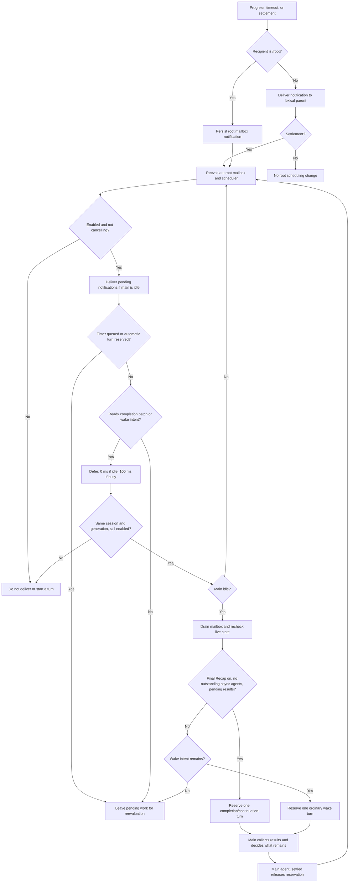
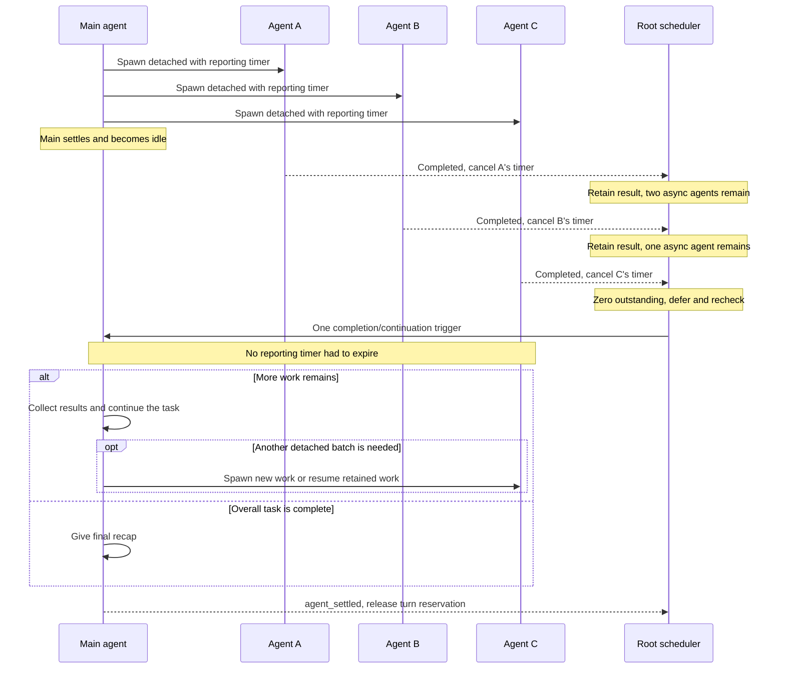
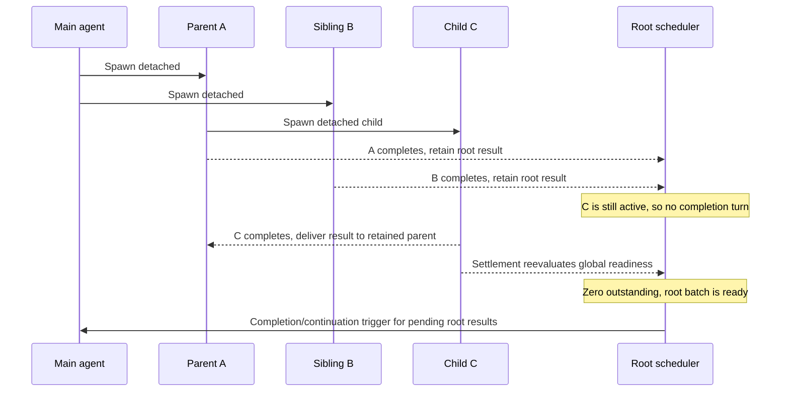
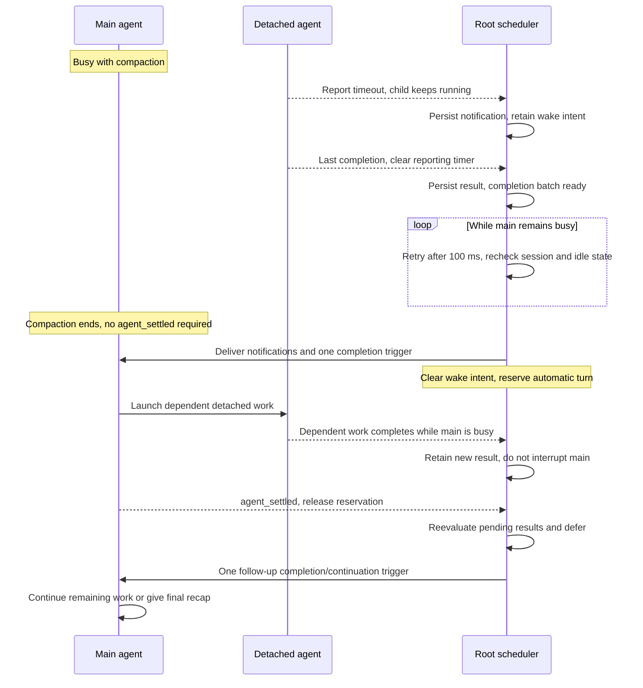

# Asynchronous completion and main-agent wakes

A detached spawn (`wait: false`) returns while its agent is still working. Completion and reporting timeouts are separate signals: finishing cancels the agent's reporting timer, then reevaluates whether the main agent should run. It never waits for that timer to expire.

With [Final Recap](settings.md#labs-final-recap-finalrecap) enabled, completed, failed, and stopped detached agents contribute to a pending completion batch. The batch becomes ready when **no detached agent is starting or running**, including nested descendants. Without Final Recap, detached settlements request ordinary wakes instead of waiting for a batch. Progress alone does not request a turn; foreground results do not request an extra completion turn. A detached pause requests an ordinary wake, not a final-result recap.

The scheduler knows whether a batch is ready—not whether the user's task is finished. Both kinds of trigger tell the main agent to collect results and continue unfinished work, or give a final recap if the overall task is complete.

## Delivery and scheduling flow

Root-directed events are persisted before delivery. When main is idle, their notifications enter model context without triggering a turn or appearing as the final visible chat message. A single scheduler then chooses a completion/continuation trigger or an ordinary wake.

A report-only timeout requests a wake while the child is **still running**; it does not stop the child. If a ready completion batch and timeout wake are pending at the same scheduling boundary, the completion trigger takes priority and clears the pending wake intent. Their notifications are available in that one turn. A timeout turn that already started is not retroactively merged with a later completion.

The 0 ms deferral leaves the current settlement boundary and coalesces events already arriving together. The 100 ms busy retry also covers compaction, so delivery does not depend solely on a later main-agent `agent_settled` event. These are scheduling delays, not guaranteed response deadlines.

## Timing: siblings finish before their reporting timers

This example has Final Recap on. Time runs downward; all three agents finish before their report deadlines.

“Batch” is a scheduling group, not a separate job object. Readiness is checked against the manager's current detached-agent count. New detached work can make the next completion batch wait again.

## Timing: a nested descendant finishes last

A nested result still belongs to its lexical parent. Its settlement must also reevaluate the root scheduler because the global outstanding count includes that descendant.

C's result is not copied into the root mailbox by this path. The main agent can inspect descendant output when needed. Delivery to a retained parent does not itself restart that parent.

## Timing: busy main, coalesced signals, and follow-up work

Final Recap is on here. A timeout and the last completion arrive during compaction. Later, the automatic turn launches dependent work that finishes before main settles.

## Lossless recovery from upstream interruptions

A dropped provider stream is an accident, not a verdict. Two layers rebuild the turn without editing the task or the conversation:

| Layer | Catches | Mechanism |
| --- | --- | --- |
| Request (`src/orch/stream-retry.ts`) | The stream died **before any content** arrived | The `start` event is withheld until real content shows up, so a dead request leaves nothing behind. The request is retried in place; the agent loop never sees the failure. |
| Turn (`src/orch/runtime.ts`) | The stream died **after partial output** | The failed assistant message and that turn's tool results are hidden with `sessionManager.appendContextEdit(id, null)`, `session.refreshContext()` reprojects agent state, and `agent.continue()` reruns the turn from the context it had before it started. The transcript keeps both the abandoned turn and the edit that hid it. |

- Both layers back off 10 s / 30 s / 90 s (three attempts) and stop immediately on a user stop, a pause, a shutdown, or a budget kill.
- Only transient failures are retried: `aborted` streams, rate limits, 5xx, network errors. Quota/billing errors and context overflows are terminal on the first try.
- Recovery is **progress, not an outcome**: it emits a `recovery` driver event that updates the thread status (`Upstream interruption; lossless recovery 1/3 in 30s`, then `Recovered after 1 upstream interruption`) and never wakes the parent.
- The parent is woken once, at the end. A failure report names what actually happened: `upstream-interrupted` or `model-error`, the provider's own words, every interruption attempt, and the tokens actually spent — with an explicit note when the budget was never the cause. A budget kill keeps its own `budget` attribution instead of looking like a caller stop.
- Reverting a turn discards that turn's partial output. Agents that must not lose work stream it to a file as they go.

## Settings, cancellation, and persistence

- **Subagent Mode Off:** suppresses notification delivery and automatic turns. Matching-session mailbox entries remain available for reconciliation when enabled. **Final Recap off** changes detached completion behavior to ordinary wakes; it is not a master switch for all automatic turns.
- **One automatic turn at a time:** `rootTurnRunning` reserves a requested turn until main's `agent_settled`. Results arriving during it remain pending for a follow-up. The reservation covers both ordinary wakes and completion/continuation turns.
- **Session changes:** tree navigation, switching, and forking cancel scheduled work and suppress cancellation-generated turns while stopping old threads. Attaching a session changes the generation; shutdown cancels the timer and changes the generation too. Deferred callbacks recheck session identity and generation before acting.
- **Branch-local recovery:** root mailbox entries carry `rootSessionId` and a unique `details.mailboxId`. Delivered `pi-subagent:update` messages identify notifications already placed in context. Completion-trigger messages (`pi-subagent:final-recap`) record the completion `mailboxIds` consumed by that batch, so reconciliation does not recap those same IDs again. Ordinary wake intent is an in-memory flag, not a separate durable acknowledgment log.

These records track notification delivery and trigger consumption, not successful completion of the user's task. The scheduler calls `pi.sendMessage` with `triggerTurn: true`; it does not receive an acknowledgment that the resulting model turn succeeded.

## Implementation and regression coverage

- [`src/index.ts`](../src/index.ts): `delivery`, `pendingRootNotifications`, `pendingSummaries`, `scheduleRootTurn`, and session lifecycle hooks.
- [`src/orch/manager.ts`](../src/orch/manager.ts): `outstandingAsync`, reporting timers, and terminal-state settlement.
- [`src/orch/stream-retry.ts`](../src/orch/stream-retry.ts), [`src/orch/interrupted.ts`](../src/orch/interrupted.ts): request-level retry and the faithful interruption report.
- [`tests/stream-retry.test.ts`](../tests/stream-retry.test.ts), [`tests/recovery.test.ts`](../tests/recovery.test.ts): withheld `start`, retry exhaustion, non-retryable providers, local stop/pause never recovering, replay from the same session, and the retained transcript.
- [`tests/final-recap-integration.test.ts`](../tests/final-recap-integration.test.ts): all six completion orders for three timed siblings, nested-last completion, busy-state retry, timeout/completion coalescing, and completion during an automatic continuation. The compaction case simulates the SDK's busy state; it does not run a content-compaction pass.
